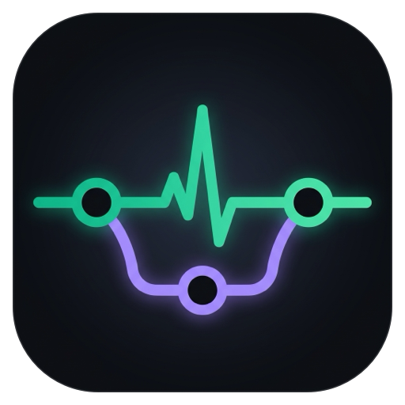
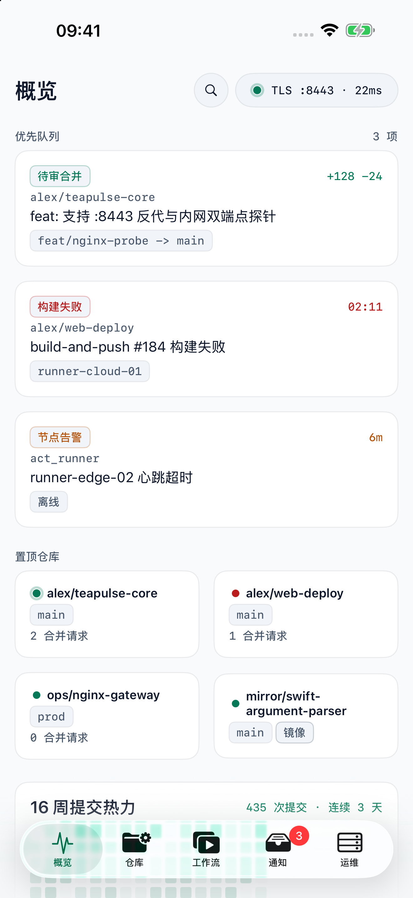
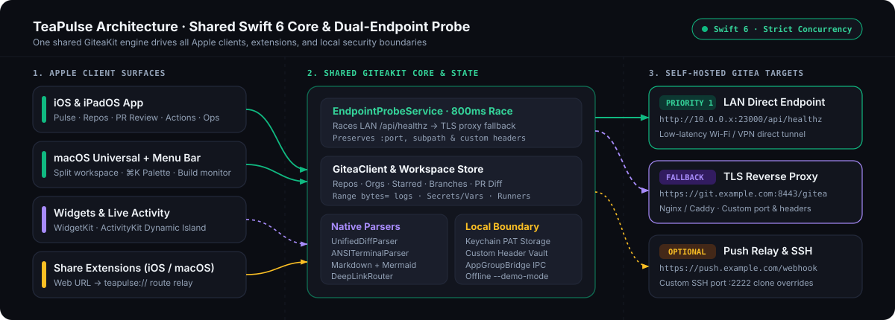

<div align="center">
  
  <h1>TeaPulse</h1>
  <p><strong>Native SwiftUI universal client (iOS / iPadOS / macOS) for self-hosted Gitea instances and CI/CD operations</strong></p>
  <p>
    <strong>English</strong> ·
    <a href="README.zh-CN.md">简体中文</a> ·
    <a href="#quick-start--demo-mode">Quick Start</a> ·
    <a href="#architecture--dual-endpoint-core">Architecture</a> ·
    <a href="#signing--project-structure">Signing &amp; Build</a> ·
    <a href="LICENSE">GPL-3.0</a>
  </p>
</div>

---

Built specifically for operators and developers running **self-hosted Gitea 1.27+** behind custom reverse-proxy ports, subpaths (such as `/gitea`), gateway auth headers, or LAN/WAN split networks. Powered by a shared Swift 6 core package (`GiteaKit`), one codebase drives iPhone, iPad, macOS, Menu Bar monitoring, WidgetKit widgets, Live Activities, and URL Share Extensions.

> [!NOTE]
> **v0.1.0 Open-Source Status**: Core networking (`GiteaKitTests`, 29 tests), mocked live-connection & `AppStore` tests, iOS unit/UI smoke tests, macOS tests, and the offline `--demo-mode` workspace are verified locally. End-to-end validation against live production Gitea hardware, physical iPhone Dynamic Island (`ActivityKit`), and hardware Share Extension panels remains in active integration testing.

## Live Preview (`--demo-mode` Simulator Capture)

<table>
  <tr>
    <td width="340" align="center">
      
    </td>
    <td valign="top">
      <h3>Designed for High-Signal Gitea Operations</h3>
      <ul>
        <li><strong>Pulse Operations Dashboard</strong>: Aggregates open pull requests, failed workflow runs, and offline runners into a Priority Queue alongside 4 custom pinned repositories, an interactive 16-week animated commit heatmap, and activity feeds.</li>
        <li><strong>800ms Dual-Endpoint Race Probe</strong>: Races direct LAN <code>/api/healthz</code> (800ms cutoff) against your HTTPS reverse proxy, switching channels transparently without stalling navigation.</li>
        <li><strong>Repositories, Organizations &amp; Branches</strong>: Filters personal, organization (<code>/user/orgs</code>), and mirror repositories; supports starring toggles, branch/tag switching, commit history, single-commit diffs, and Markdown + inline Mermaid rendering.</li>
        <li><strong>Inline Code Review &amp; Diff Reader</strong>: Parses unified diffs natively with Unified / Split view modes and inline review drafts anchored to exact old/new lines (<code>POST /pulls/{index}/reviews</code>).</li>
        <li><strong>Workflows &amp; ANSI Terminal Logs</strong>: Collapses <code>::group::</code> steps, renders ANSI highlights with auto-jump to the first error line, streams incremental <code>Range: bytes=</code> logs, and manages Secrets, Variables, and <code>act_runner</code> nodes.</li>
      </ul>
    </td>
  </tr>
</table>

## Architecture & Dual-Endpoint Core

Generic Git mobile apps typically assume standard port `443` at the root domain—breaking on custom ports (`:8443`), reverse-proxy subpaths (`/gitea`), Cloudflare/gateway headers, Nginx `413` release asset limits, or Wi-Fi LAN-to-WAN handoffs. **TeaPulse** isolates all protocol and parser logic inside pure Swift 6 `GiteaKit`:

<p align="center">
  
</p>

- **Strict URL Boundary Isolation**: `GiteaURLBuilder` percent-encodes path segments once while preserving custom `:port` numbers and subpaths; `/api/healthz` probes bypass `/api/v1` prefixes automatically.
- **Reverse-Proxy Diagnostics**: Surfaces explicit `client_max_body_size` remediation hints when Nginx returns HTTP `413` on release uploads, and polls `Range: bytes=` job logs for `proxy_buffering off` setups.
- **Shared Extension Routing**: iOS & macOS Share Extensions normalize web URLs into `teapulse://repo/...`, `teapulse://pull/...`, and `teapulse://actions/...` routes via App Group IPC, loading uncached targets on demand on cold start.
- **Local-Only Security Boundary**: Personal Access Tokens (PAT) and custom proxy headers live exclusively in Apple Keychain—zero telemetry servers or external relays.

## Quick Start & Demo Mode

Explore the entire interface and run core package tests locally without an existing Gitea server or paid Apple Developer account.

### 1. Run Core Package Tests (`GiteaKitTests`)

```bash
git clone https://github.com/maydaychen/GitPulse.git
cd GitPulse
swift test
```

### 2. Launch `--demo-mode` in Xcode / iOS Simulator

Personal signing teams are decoupled from version control (see [`Config/Signing.xcconfig`](Config/Signing.xcconfig) and [`Config/LocalSigning.example.xcconfig`](Config/LocalSigning.example.xcconfig)), so Simulator and unsigned macOS targets compile out of the box:

```bash
# Regenerate TeaPulse.xcodeproj if you modify target configuration (requires `brew install xcodegen`)
xcodegen generate

open TeaPulse.xcodeproj
```

- In the `TeaPulse` scheme under **Run -> Arguments -> Arguments Passed On Launch**, add `--demo-mode` to enter the offline workspace populated with sanitized repositories, PR diffs, and ANSI workflow logs.
- For personal physical-device or Archive signing, create the gitignored override file:

```bash
cp Config/LocalSigning.example.xcconfig Config/LocalSigning.xcconfig
# Edit Config/LocalSigning.xcconfig with your Apple DEVELOPMENT_TEAM
```

### 3. Connect a Self-Hosted Gitea Instance

1. Generate a **Personal Access Token (PAT)** in your Gitea user settings (password/2FA login is disabled by design).
2. Configure the instance onboarding sheet:
   - **Public Reverse-Proxy URL**: e.g. `https://git.example.com:8443` or `https://git.example.com:8443/gitea`
   - **Optional LAN Direct URL**: e.g. `http://10.0.0.18:23000`
   - **Optional Custom Proxy Headers**: for Cloudflare Access or zero-trust reverse proxies
3. If deploying behind Nginx, configure `client_max_body_size` for release assets and `proxy_buffering off` for incremental workflow logs.

## Signing & Project Structure

```text
GitPulse/
├── Package.swift                    # Local GiteaKit Swift 6 package manifest
├── project.yml                      # XcodeGen spec (iOS / macOS / Extensions / Tests)
├── DESIGN.md                        # Single source of truth for dark/light design tokens
├── Sources/GiteaKit/                # Models, dual-endpoint probe, REST client, Diff/ANSI/Markdown parsers
├── Tests/GiteaKitTests/             # Swift Testing unit suite
├── SharedExtensionSupport/          # TeaPulseTheme tokens, shared components, AppGroupBridge IPC
├── TeaPulse/                        # Universal SwiftUI app (App / Navigation / Store / Features)
├── TeaPulseWidgets/                 # iOS WidgetKit & ActivityKit Live Activity
├── TeaPulseShareExtension/          # iOS Share Extension
├── TeaPulseMacWidgets/              # macOS WidgetKit extension
├── TeaPulseMacShareExtension/       # macOS Share Extension
├── TeaPulseTests/ & TeaPulseUITests/# iOS unit & UI smoke tests
├── TeaPulseMacTests/                # macOS workspace unit tests
├── Config/                          # Signing.xcconfig, LocalSigning template, Info.plist & entitlements
└── scripts/                         # Design token guard, DESIGN.md lint, clean open-source exporter
```

| Check / Target | Command | Scope |
| --- | --- | --- |
| Core Swift Package | `swift test` | URL builder, 800ms endpoint probe, Gitea REST parsing, Diff / ANSI / Markdown & DeepLinks |
| Design Token Guard | `python3 scripts/check-design-tokens.py` | Enforces zero hardcoded visual hex literals outside [`TeaPulseTheme.swift`](SharedExtensionSupport/TeaPulseTheme.swift) |
| Design Spec Lint | `python3 scripts/lint-design-md.py DESIGN.md` | Validates [`DESIGN.md`](DESIGN.md) token structure and contrast rules |
| Clean Public Snapshot | `bash scripts/export-clean-opensource.sh` | Exports a single-commit open-source snapshot without internal harness tooling |

## License

Released under the **[GNU General Public License v3.0 (GPL-3.0)](LICENSE)**.
