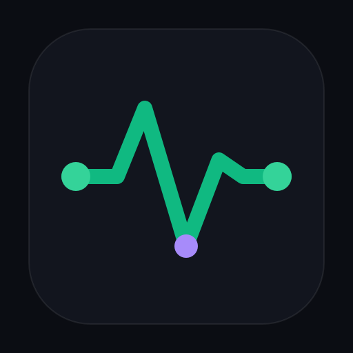
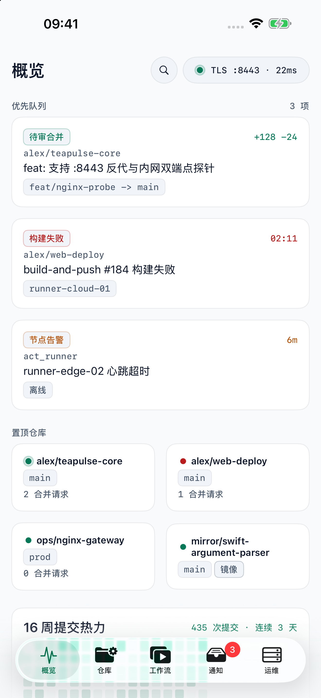
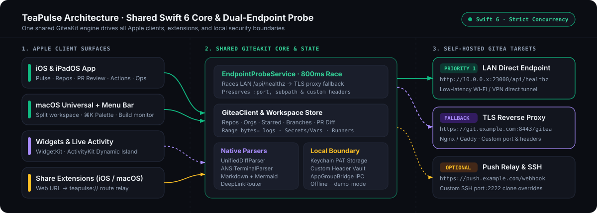

<div align="center">
  
  <h1>TeaPulse</h1>
  <p><strong>面向自托管 Gitea 与 CI 运维场景的 Universal 原生 SwiftUI 客户端（iOS / iPadOS / macOS）</strong></p>
  <p>
    <a href="README.md">English</a> ·
    <strong>简体中文</strong> ·
    <a href="#快速上手--demo-模式零门槛体验">快速上手</a> ·
    <a href="#核心机制与系统架构">架构机制</a> ·
    <a href="#开发者签名与项目结构">签名与构建</a> ·
    <a href="LICENSE">GPL-3.0</a>
  </p>
</div>

---

专为使用 **自定义端口 TLS 反代**（如 Nginx / Caddy、子路径部署、Cloudflare Access 请求头）以及 **内网直连 / 公网回落切换** 的 Gitea 管理员与开发者打造。底层由共享 Swift 6 核心库 `GiteaKit` 驱动，一次维护同步支持 iPhone、iPad、macOS、菜单栏监控、WidgetKit 小组件、Live Activity 与 Share Extension。

> [!NOTE]
> **当前开源状态说明（v0.1.0）**：核心网络层 `GiteaKitTests`（29 项）、iOS 单元与 UI 冒烟测试、macOS 单元测试及 `--demo-mode` 离线演示数据均已稳定运行并通过本地回归；连接真实自托管 Gitea 实例的端到端验收以及 iOS 真机灵动岛（ActivityKit）、系统 Share Extension 面板仍处于持续真机联调阶段。

## 真实界面预览（Demo 模式实机截图）

<table>
  <tr>
    <td width="340" align="center">
      
    </td>
    <td valign="top">
      <h3>专为高频运维设计的核心视图</h3>
      <ul>
        <li><strong>概览看板（Pulse）</strong>：聚合待审 PR、失败工作流与离线 Runner 到优先队列；支持 4 仓首页自定义置顶、16 周提交热力图动态波纹与个人主页活动流。</li>
        <li><strong>双端点 800ms 竞速探针</strong>：优先探测内网直连 <code>/api/healthz</code>（800ms 超时阈值），不可达时自动无感切换至 TLS 反代端点，并在状态胶囊实时显示当前通道与延迟。</li>
        <li><strong>仓库、分支与目录浏览</strong>：支持个人 / 组织 / 镜像分范围筛选、按具体组织筛选（<code>/user/orgs</code>）、收藏点星、分支 / Tag 切换、最近提交与单次 Commit Diff，以及 Markdown + 内联 Mermaid 渲染。</li>
        <li><strong>代码评审与只读 Diff</strong>：内嵌解析 Unified Diff，支持 Unified / Split 视图切换与携带旧行 / 新行侧定位的行内批注（<code>POST /pulls/{index}/reviews</code>）。</li>
        <li><strong>工作流与 ANSI 终端日志</strong>：按 <code>::group::</code> 折叠步骤、高亮着色并自动定位首个报错行，按需拉取 <code>Range: bytes=</code> 增量日志及 Secrets / Variables CRUD、Runners 状态监控。</li>
      </ul>
    </td>
  </tr>
</table>

## 核心机制与系统架构

许多通用 Git 客户端默认假设托管服务挂在标准 `443` 根域名下，遇到自建反代（自定义端口 `:8443`、子路径 `/gitea`、网关鉴权头、大文件上传 413 限额或内网 / 公网切网）时往往直接报解析失败或长期卡死。TeaPulse 将所有端共用逻辑下沉进 Pure Swift 6 包 `GiteaKit`：

<p align="center">
  
</p>

- **严格分离 URL 构造边界**：`GiteaURLBuilder` 对路径段逐段单次百分号编码并无损保留自定义端口与反代前缀；`/api/healthz` 健康探针独立于 `/api/v1`，避免误拼版本前缀。
- **反代常见故障语义提示**：发布资产上传命中 Nginx HTTP `413` 时直接提示检查 `client_max_body_size`；流式日志拉取适配 `proxy_buffering off` 增量分段。
- **多端扩展共享同一路由协议**：iOS / macOS Share Extension 将任意 Gitea 网页 URL 规范化为 `teapulse://repo/...`、`teapulse://pull/...`、`teapulse://actions/...` 并通过 App Group 投递给主应用，冷启动或未预加载仓库可按需拉取跳转。
- **纯本地凭据安全边界**：个人访问令牌（PAT）与自定义反代请求头仅存放在 Apple Keychain；无任何第三方统计或中转服务器。

## 快速上手 · Demo 模式零门槛体验

可以直接下载双端匿名安装包体验，或在没有现成 Gitea 服务器与 Apple Developer 付费账号的情况下，通过 SwiftPM 单元测试和内置 `--demo-mode` 在本机体验完整工作流。

### 方式一：下载预编译匿名安装包（[GitHub Releases](https://github.com/maydaychen/GitPulse/releases)）

> [!IMPORTANT]
> 为保证开源构建完全剥离个人 Apple 实名信息，Releases 安装包默认不嵌入开发者 Team ID 与公证证书（macOS 为本地 `adhoc` 签名，iOS 为无签名 `.ipa`）。

- **macOS（`TeaPulse-<version>-macOS.dmg`）**：打开 DMG 将 `TeaPulse.app` 拖入「应用程序」。首次打开时会触发系统未认证提示（[Apple 官方说明](https://support.apple.com/zh-cn/102445)）：
  - **界面操作**：弹窗点击「完成」，进入 **系统设置 -> 隐私与安全性** 底部点击 **「仍要打开」** 放行一次即可。
  - **终端命令**：在终端执行一次 `xattr -cr /Applications/TeaPulse.app` 清除下载隔离标志后直接双击运行。
- **iOS / iPadOS（`TeaPulse-<version>-iOS-unsigned.ipa`）**：使用 **AltStore / SideStore** 配合个人 Apple ID 侧载安装，或按下方步骤使用免费个人 Apple ID 通过 Xcode 编译装机。

### 1. 运行核心测试（`GiteaKitTests`）

```bash
git clone https://github.com/maydaychen/GitPulse.git
cd GitPulse
swift test
```

### 2. 在 Xcode / iOS 模拟器中运行 `--demo-mode`

仓库已将发布签名 Team ID 解耦出版本控制（见 [`Config/Signing.xcconfig`](Config/Signing.xcconfig) 与 [`Config/LocalSigning.example.xcconfig`](Config/LocalSigning.example.xcconfig)），下载源码后直接开箱编译模拟器与本地 macOS 版本：

```bash
# 如需修改目标结构或重新生成 TeaPulse.xcodeproj（需先 brew install xcodegen）
xcodegen generate

# 在 Xcode 中打开工程，或使用命令行编译运行至 iOS 模拟器
open TeaPulse.xcodeproj
```

- 在 Xcode Scheme 的 `Run -> Arguments -> Arguments Passed On Launch` 中加入 `--demo-mode`，即可跳过登录网关直接进入含热力图、PR Diff、ANSI 构建日志与多组织仓库的离线演示工作区。
- 若使用命令行为真机签名或归档，先复制模板创建本地 Git 忽略的签名覆盖文件：

```bash
cp Config/LocalSigning.example.xcconfig Config/LocalSigning.xcconfig
# 编辑 Config/LocalSigning.xcconfig，填入你的 Apple DEVELOPMENT_TEAM
```

### 3. 连接真实自托管 Gitea 实例

1. 在 Gitea 用户设置生成 **Personal Access Token（PAT）**（TeaPulse 不支持账号密码或 2FA，仅使用 PAT 与可选反代请求头）。
2. 在连接配置面板依次填写：
   - **公网反代地址**（如 `https://git.example.com:8443` 或 `https://git.example.com:8443/gitea`）
   - **可选内网直连地址**（如 `http://10.0.0.18:23000`）
   - **可选自定义反代请求头**（适用于 Cloudflare Access / 自建鉴权网关）
3. 若反代前部署了 Nginx 且需通过 App 上传 Release 附件，建议在服务端配置 `client_max_body_size` 并关闭流式日志缓冲 `proxy_buffering off`。

## 开发者签名与项目结构

```text
GitPulse/
├── Package.swift                    # GiteaKit 本地 Swift 6 Package 定义
├── project.yml                      # XcodeGen 工程声明（iOS / macOS / Extensions / Tests）
├── DESIGN.md                        # 单一视觉规范源（深浅双色、字号与间距令牌）
├── Sources/GiteaKit/                # 领域模型、双端点探针、REST 客户端、Diff/ANSI/Markdown 解析器
├── Tests/GiteaKitTests/             # Swift Testing 核心单测套件
├── SharedExtensionSupport/          # TeaPulseTheme 主题令牌、共享组件与 AppGroupBridge IPC
├── TeaPulse/                        # Universal SwiftUI 主工程源码（App / Navigation / Store / Features）
├── TeaPulseWidgets/                 # iOS WidgetKit 小组件 & ActivityKit 灵动岛
├── TeaPulseShareExtension/          # iOS 系统分享扩展
├── TeaPulseMacWidgets/              # macOS WidgetKit 小组件
├── TeaPulseMacShareExtension/       # macOS 系统分享扩展
├── TeaPulseTests/ & TeaPulseUITests/# iOS 单元与 UI 冒烟测试
├── TeaPulseMacTests/                # macOS 单元测试
├── Config/                          # Signing.xcconfig、LocalSigning 模板、Info.plist 与 Entitlements
└── scripts/                         # 设计令牌校验、DESIGN.md lint 与干净开源导出脚本
```

| 校验 / 平台 | 运行命令 | 说明 |
| --- | --- | --- |
| 核心 Swift Package | `swift test` | 覆盖 URL 构造、双端点探针、REST 解析、Diff / ANSI / Markdown 与 DeepLink 路由 |
| 设计令牌门禁 | `python3 scripts/check-design-tokens.py` | 校验所有 UI 视图均消费 [`SharedExtensionSupport`](SharedExtensionSupport/TeaPulseTheme.swift) 令牌 |
| 设计规范 Lint | `python3 scripts/lint-design-md.py DESIGN.md` | 校验 [`DESIGN.md`](DESIGN.md) 结构与语义合规 |
| 匿名双端 Release 打包 | `bash scripts/build-anonymous-release.sh` | 构建剥离 Team ID 的 `macOS .dmg`、无签名 `iOS .ipa` 与 `SHA256SUMS.txt` |
| 开源快照导出 | `bash scripts/export-clean-opensource.sh` | 在临时目录生成单提交、剔除内部开发脚手架的纯净公开快照 |

## 开源协议（License）

本项目采用 **[GNU General Public License v3.0 (GPL-3.0)](LICENSE)** 开源协议发布。详情请查阅仓库根目录下的 [`LICENSE`](LICENSE) 文件。
